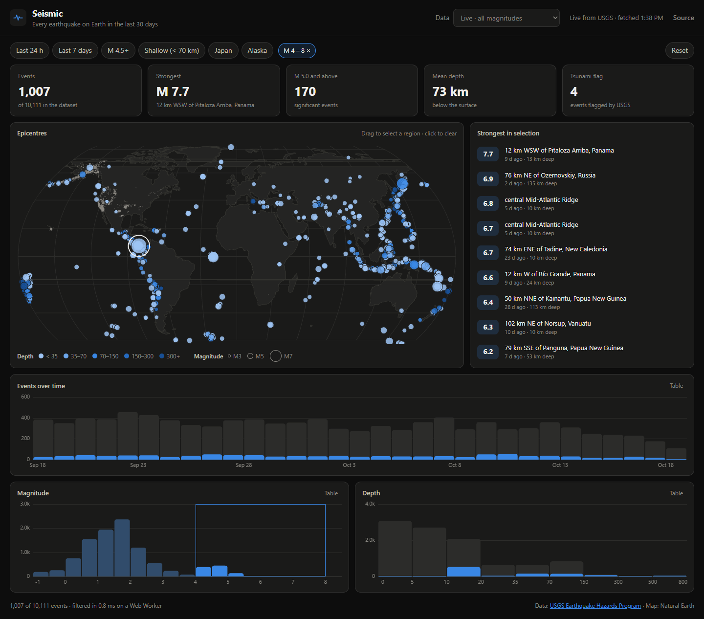
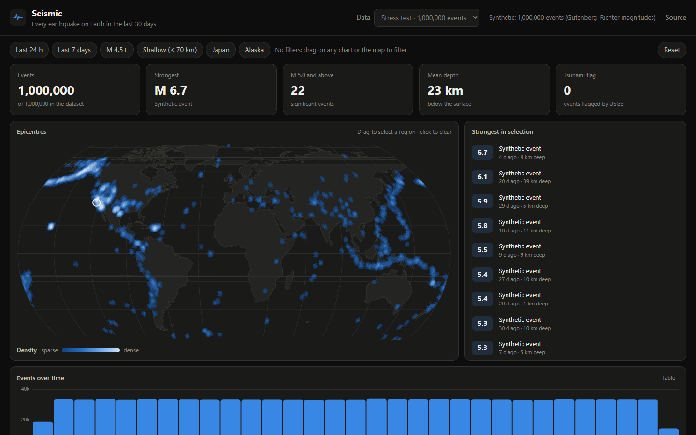

<div align="center">

# Seismic

**Every earthquake on Earth in the last 30 days, live from USGS.**
Linked crossfilter charts, aggregation in a Web Worker, and a stress mode with a million points. TypeScript, Canvas 2D, no chart or map library.

[**▶ Open the dashboard**](https://chop-prog.github.io/seismic/)



</div>

## What you can do

- **Brush any histogram** (time, magnitude, depth) or **drag a region on the map**. Every other view re-aggregates instantly, and active filters appear as removable chips in one row above the charts.
- **Quick filters:** last 24 h, last 7 days, M 4.5+, shallow (< 70 km), Japan, Alaska.
- **Hover** map points and bars for details. The **Strongest in selection** list highlights each event on the map and links to its USGS page.
- **Table view** for every chart, so values never depend on colour or hover.
- **Data source:** live USGS feed (all magnitudes or M2.5+), a bundled offline snapshot (used automatically if USGS is unreachable), or a **1,000,000-event stress test**.



## Engineering notes

**Crossfilter in one pass.** For each record, the engine computes a bitmask of the filters it fails:

- `0` — it is selected and counts in every histogram;
- exactly one bit set — it still counts in *that* dimension's histogram.

So each chart shows what its own brush would pick from, which is real crossfilter semantics, in O(n) with no per-dimension re-scans. A randomized test checks it against a naive reference implementation.

**Columnar data in typed arrays.** `Float32Array` / `Float64Array` columns hold a million rows in about 25 MB and keep the hot loop cache-friendly. Bin indices are precomputed once (`Uint16Array`), so each filter pass is integer work only. The selection mask is **transferred**, not copied, back from the worker.

**Measured:** 10k live events filter in ≈ 0.8 ms; **1M events in ≈ 15 ms** on a Web Worker, so the UI thread never runs the O(n) loop.

**Two rendering paths.** Up to 60k events, epicentres are drawn as circles: sized by magnitude, coloured by depth class, small events first, with a 1px surface ring between overlaps. Nearest-point hover uses a screen-space grid index. Beyond that, the map switches to a **log-scaled density raster** built directly in an `ImageData` buffer.

**Cartography from scratch.** A ~40-line **TopoJSON decoder** (delta + quantisation, reversed-arc stitching) and the **Natural Earth I projection**, including its **inverse via Newton's method**, so a dragged screen rectangle can be turned back into a lat/lon box.

**Data-viz discipline.**

- Depth uses a **single-hue ordinal ramp** whose steps were checked with a palette validator (monotone lightness, one hue, end step clears the dark surface).
- The density raster uses a sequential ramp with a legend.
- Bars have 4px rounded data ends and 2px gaps, gridlines are hairlines, and there are no dual axes.
- Filters sit in one row above the charts, and the previous render is held at reduced opacity while recomputing (no skeleton flash).

**Honest synthetic data.** The stress dataset jitters epicentres around real ones, so it follows the plate boundaries. Magnitudes follow the **Gutenberg–Richter law** (b ≈ 1), and a test checks the roughly tenfold drop per magnitude unit.

## Tests & CI

`npm test` runs **15 tests**:

- the engine against a naive reference on random filters;
- crossfilter semantics, top-K and binning;
- GeoJSON and snapshot round-trips;
- the Gutenberg–Richter statistics of the synthetic data;
- forward and inverse projection;
- TopoJSON decoding, including all 100+ real land rings.

GitHub Actions type-checks, tests, builds and deploys to Pages. A **weekly scheduled workflow** refreshes the bundled offline snapshot from USGS and commits it.

## Run locally

```bash
npm install
npm run dev
npm test
node scripts/snapshot.ts all_month.geojson   # rebuild the offline snapshot
```

Data: [USGS Earthquake Hazards Program](https://earthquake.usgs.gov/earthquakes/feed/) (public domain). Land outlines: [Natural Earth](https://www.naturalearthdata.com/) via [world-atlas](https://github.com/topojson/world-atlas).

## License

[MIT](LICENSE)
